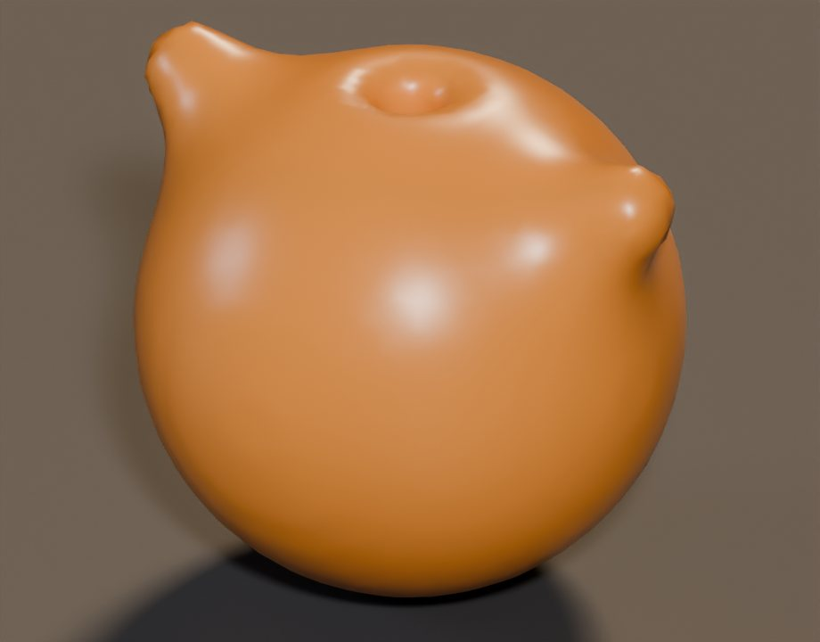
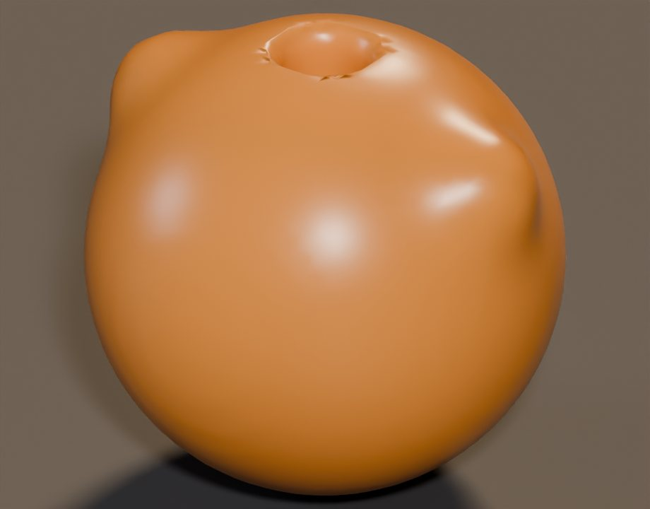

# dsh-blender-soft

DSH 宿主插件：**隐式几何 + 软约束能量**，在无头 Blender 里生成/测量/精修形状。
它只有一个工具 `blender_soft`，刻意不提供 pass/fail、不阻断交付；判定留给独立的 commit 步骤。



> A DSH host plugin that explores implicit SDF shapes under soft constraint energies in headless
> Blender. One tool — `propose` / `energy` / `refine` / `doctor` — and deliberately no verdict:
> constraints negotiate with a candidate *after* it exists, instead of pre-deciding the proposal.

## 设计取向

上游 [`sixtysevenlf/dsh-blender-plugin`](https://github.com/sixtysevenlf/dsh-blender-plugin) 是一套完整的
宿主插件，能力面比这里大得多：34 family / 228 op，`blender_rt_do` 可在持久内核里执行任意 bpy，
`spec_hash` 只覆盖 `surface_*` 这一族。它把规范放在生成之前——`skills/blender-modeling/SKILL.md` §1
的 op-first 规则、`gate_deliver` 的非 pass 即 blocked。在它自己的交付流水线里，这套约束是自洽的。

本插件只做那条流水线的前半段：**探索期不设门，约束以能量/梯度的形式在候选出现之后介入，
是否 commit 留给调用方**。取向的推导过程记在 [`docs/upstream-notes.md`](docs/upstream-notes.md)，
作为本插件为什么长成这样的背景，而不是对上游的评价。

## 安装

```bash
git clone https://github.com/PAGITYNEMO/dsh-blender-soft.git
```

前置：Blender 4.x/5.x（例如 `D:\Blender\blender-4.5.15-windows-x64\blender.exe`）。
工具按以下顺序找 Blender：`config.blenderPath` → `BLENDER_PATH` → `D:\Blender\blender-*-windows-x64\blender.exe` → `C:\Program Files\Blender Foundation\...` → PATH。

```text
plugin_manager install_bundle target=<绝对路径>/dsh-blender-soft
```

或在 DSH profile 里以 link 方式加入 `dsh.profile.bundles`。装完用 `blender_soft(op="doctor")` 验收。

## 工具契约

```json
{"op": "propose | energy | refine | doctor",
 "genome": {"bounds": [[-75,-75,-75],[75,75,75]], "resolution": 64,
   "knobs": {"r_body": {"value": 26, "min": 14, "max": 36}},
   "primitives": [
     {"id": "body", "type": "sphere", "radius": "@r_body"},
     {"id": "arm", "type": "capsule", "a": [0,0,0], "b": [26,0,20], "radius": 6, "mirror": "x"},
     {"id": "hole", "type": "cylinder", "center": [0,0,0], "radius": 7, "height": 300}
   ],
   "build": [{"op": "union", "ids": ["body","arm"], "k": 10},
             {"op": "subtract", "ids": ["hole"], "k": 4}]},
 "terms": [
   {"id": "thickness", "target": 6, "q": 0.1, "weight": 1,
    "schedule": {"start": 0.30, "end": 0.95}},
   {"id": "symmetry", "axis": "x", "weight": 0.4, "tol": 0.05,
    "schedule": {"start": 0.45, "end": 1.0}}
 ],
 "tunables": ["r_body", "r_arm"]}
```

- `propose`：自由生成（默认 t=0，权重为 0），返回几何 + 各约束的**测量值**。
- `energy`：在任意 `t` 返回 `value / effective_weight / measured / state`，以及有限差分梯度。
- `refine`：从自由形状出发，按 `schedule` 平滑升温；只动你显式暴露的 `tunables`；每步记录 `max_delta_norm`、`drift_mm`、约束值。
  `mode="hard"` 是 A/B 对照：所有权重压在最后一步一次性施加（模拟“出口闸机”），用来证明它会过冲。
- `doctor`：返回 Blender 路径/版本。

几何：SDF 基元（sphere / ellipsoid / box / capsule / cylinder / torus）+ 平滑 CSG（`union|subtract|intersect`，`k` 控制融合半径）+ `mirror`，再用 surface nets 提网格。拓扑由零等值面涌现，不预先锁截面/轨道。

## 验证（本机实测）

[`docs/soft-vs-hard.md`](docs/soft-vs-hard.md) 是完整日志。同一份 genome、同一组 terms，10 步：

| 指标 | soft（schedule） | hard（单步闸机） |
|---|---|---|
| 最大单步参数位移（归一化） | 0.08 | 0.45 |
| 最大单步表面漂移 | 1.42 mm | 7.98 mm |
| p10 厚度（目标 ≥ 6 mm） | 6.64 → 11.08 mm | 6.64 → 13.82 mm |
| 终态体积（目标 80k ±25%） | 88,509 mm³（ok） | 187,873 mm³（above） |
| 终态对称性 rms | 0.24 mm | 1.46 mm |

soft 在前 3 步权重为 0（不动物体），之后逐步介入；hard 在前 9 步完全不动，最后一步跳过 8 mm。
这就是“约束在候选出现之后和它谈判”与“在出口处把它推回去”的差别。

| soft（第 10 步） | hard（第 10 步） |
|---|---|
|  |  |
| 厚度回到带内，体积 88.5k mm³ | 单步跳过 7.98 mm，体积 187.9k mm³，孔缘被拉裂 |

中间帧：`docs/previews/{soft,hard}_{00_free,01_mid,02_refined}.jpg`。

`tests/selftest.py` 的 headless 结果：**23/23 通过**（21.52 s），见 [`docs/selftest.log`](docs/selftest.log) 与 [`docs/selftest.json`](docs/selftest.json)。
覆盖：surface nets 闭合/欧拉数/体积误差、三种基元的厚度、对称性、schedule 边界、soft 步长上界与自由期、
hard 单步大跳、体积越带、哈希确定性/谱系随 seed 变化、0.5 mm 表面漂移的度量精度。

复跑：

```bash
D:/Blender/blender-4.5.15-windows-x64/blender.exe -b --factory-startup \
  --python runtime/blender_runner.py -- runs/demo_soft/job.json
python tests/selftest.py
```

## 边界与残余风险

- v0.1 只测单场能量：厚度是“沿内法线 2×max|f|”的下界；多部件 clearance、自交、装配配合尚未实现。
- surface nets 的分辨率本身就是一种先验：薄壁/小孔在低分辨率下会消失；提高 `resolution` 或缩小 `bounds` 可缓解。
- 仍然可能“过分影响发挥”的最后一处：**调用方替模型选 tunables**。如果只暴露 2 个旋钮，模型仍被限制在 2 维子空间——插件只能保证“不替它选结构”，不能保证“调用方不替它选自由度”。
- 本插件不替代上游 15 工具；它证明的是约束姿态可以换掉，而不是 45k 行内核需要重写。

## 文档

- [`docs/upstream-notes.md`](docs/upstream-notes.md)：上游源码笔记，本插件取向的来源
- [`docs/soft-vs-hard.md`](docs/soft-vs-hard.md)：soft / hard 两种调度方式的完整日志
- [`docs/DESIGN-BRIEF.md`](docs/DESIGN-BRIEF.md)：生成这个插件的原始任务书
- [`docs/selftest.log`](docs/selftest.log)、[`docs/selftest.json`](docs/selftest.json)：headless 自测输出
- `runs/*/job.json`、`runs/*/result.json`：上面表格对应的原始输入与输出（`*.glb` / `*.png` 不入库，可复跑生成）

## License

MIT © 2026 PAGITYNEMO
